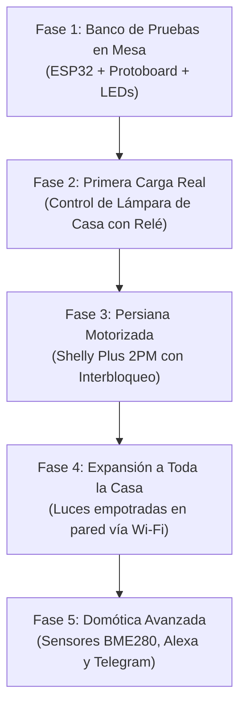

# 📋 Plan Director de Domótica: Casa Cebollo

> **SISTEMA DE AUTOMATIZACIÓN INALÁMBRICA WI-FI PARA VIVIENDA EXISTENTE**  
> Proyecto de domotización paso a paso para iluminación y persiana motorizada basado en microcontroladores ESP32, sin obras ni cables entre habitaciones.

---

## 🏠 1. Visión y Premisas del Proyecto

- **Tipo de vivienda:** Vivienda ya construida ("Casa Cebollo").
- **Restricción física fundamental:** Cero obras y cero cables nuevos por pasillos o canaletas vistas.
- **Topología de comunicación:** **100% Inalámbrica por Wi-Fi** en red local doméstica.
- **Cerebro del sistema:** Microcontroladores **ESP32** (tanto en placa de desarrollo como en pastillas empotrables certificadas).
- **Usabilidad familiar:** Los interruptores y pulsadores físicos de pared existentes **deben seguir funcionando siempre** (con o sin Wi-Fi).
- **Alcance principal:**
  1. Control total de **iluminación** de las estancias principales.
  2. Control seguro de **persiana motorizada** con interbloqueo mutuo.
  3. Panel web unificado accesible desde cualquier teléfono móvil o PC en la red local.

---

## 🌐 2. Arquitectura del Sistema (Maestro - Nodos por Wi-Fi)

En lugar de tener que abrir una dirección IP distinta para cada luz de la casa, el sistema utiliza una arquitectura distribuida transparente:

```text
                                [ Móvil / Tablet / PC ]
                                          │
                                          │ Wi-Fi Local (HTTP / Web)
                                          ▼
                         ┌─────────────────────────────────┐
                         │   ESP32 MAESTRO (Hub Central)   │
                         │   Servidor Web con Panel Único  │
                         └─────────────────────────────────┘
                                   │             │
                    ┌──────────────┘             └──────────────┐
                    │ Wi-Fi Local                               │ Wi-Fi Local
                    ▼                                           ▼
       ┌────────────────────────┐                  ┌────────────────────────┐
       │   Nodo ESP Salón       │                  │   Nodo ESP Cocina      │
       │   (Shelly Plus 1)      │                  │   (Sonoff Mini R4)     │
       │   [Luz Principal]      │                  │   [Luz Techo]          │
       └────────────────────────┘                  └────────────────────────┘
                    │                                           │
                    ▼ Wi-Fi Local                               ▼ Wi-Fi Local
       ┌────────────────────────┐                  ┌────────────────────────┐
       │   Nodo ESP Dormitorio  │                  │   Nodo ESP Persiana    │
       │   [Lámpara de Noche]   │                  │   (Shelly Plus 2PM)    │
       │                        │                  │   [Motor Subir/Bajar]  │
       └────────────────────────┘                  └────────────────────────┘
```

1. **ESP32 Maestro:** Sirve un único panel web moderno y táctil organizado por habitaciones (Salón, Cocina, Dormitorio, etc.).
2. **Nodos ESP Distribuidos:** Pequeñas pastillas con ESP32 ocultas dentro de las cajas de los interruptores o en las cajas de registro del techo. Se comunican por Wi-Fi con el Maestro al instante.

---

## 🚀 3. Fases de Ejecución Paso a Paso



---

### 🔹 Fase 1: Banco de Pruebas y Aprendizaje en Mesa (Baja Tensión)
* **Objetivo:** Adquirir soltura con el ESP32, la programación en Arduino C++, el servidor web y la lógica de conmutación sin tocar cables de 230V.
* **Componentes:**
  - 1x ESP32 NodeMCU (ESP32-WROOM-32 de 30 o 38 pines).
  - 1x Protoboard y cables jumper Dupont.
  - Pack de LEDs (rojo, verde, amarillo) y resistencias de 220 Ω / 330 Ω.
* **Pasos:**
  1. Conectar el ESP32 por USB al ordenador y cargar el sketch base.
  2. Implementar el servidor web con botones para "Luz 1", "Luz 2" y "Persiana".
  3. Simular el encendido de luces encendiendo los LEDs en la protoboard.
  4. Simular la persiana: LED Verde = Subir, LED Rojo = Bajar. Programar el **interbloqueo por software** (si está subiendo y pulsas bajar, la subida se detiene de inmediato con tiempo muerto de seguridad).

---

### 🔹 Fase 2: Primera Carga Real – La Lámpara de Casa
* **Objetivo:** Pasar del LED de prueba al control de un electrodoméstico real a 230V con total seguridad.
* **Componentes:**
  - El ESP32 de la Fase 1.
  - 1x Módulo Relé de 1 canal (o 2 canales) optoacoplado de 5V (señal lógica 3.3V).
  - 1x Caja plástica aislante pequeña (para alojar el relé).
  - Lámpara de mesa o de pie con enchufe.
* **Pasos:**
  1. **Prueba en vacío:** Conectar el relé al ESP32 sin enchufar la lámpara. Pulsar el botón en el móvil y escuchar el "clic" mecánico y ver el LED del relé.
  2. **Conexión de la lámpara (con enchufe desconectado):**
     - Cortar únicamente el hilo de la **Fase** del cable de la lámpara.
     - Conectar los extremos a los bornes `COM` (Común) y `NO` (Normalmente Abierto) del relé.
     - El hilo del **Neutro** queda intacto directo a la bombilla.
  3. Cerrar la caja plástica protectora y enchufar la lámpara a la red.
  4. Comprobar el encendido y apagado desde el navegador del móvil.

---

### 🔹 Fase 3: La Persiana Motorizada (Seguridad e Interbloqueo)
* **Objetivo:** Automatizar la persiana tubular de Casa Cebollo garantizando que nunca se crucen las fases de subida y bajada.
* **Componentes:**
  - 1x **Shelly Plus 2PM** (módulo empotrable con chip ESP32 e interbloqueo por hardware certificado).
* **Pasos:**
  1. Bajar el diferencial de corriente en el cuadro de Casa Cebollo antes de abrir el mecanismo.
  2. Identificar los 4 cables del motor:
     - **Azul:** Neutro (N).
     - **Verde/Amarillo:** Tierra (GND).
     - **Marrón:** Fase Subir (va a la salida O1 del módulo).
     - **Negro:** Fase Bajar (va a la salida O2 del módulo).
  3. Conectar los pulsadores físicos existentes de la pared a las entradas SW1 y SW2 del módulo.
  4. Configurar el modo *Roller Shutter* y calibrar el tiempo de recorrido (permite comandos como "Abrir al 50%").
  5. Integrar el control de la persiana en el panel web unificado.

---

### 🔹 Fase 4: Expansión Inalámbrica a Toda la Casa (Iluminación Completa)
* **Objetivo:** Domotizar el resto de estancias (Salón, Cocina, Pasillo, Dormitorios) sin obras.
* **Componentes:**
  - Módulos empotrables **Shelly Plus 1** o **Sonoff Mini R4** (1 por cada circuito de luz independiente).
* **Pasos:**
  1. Colocar las pastillas detrás de los interruptores de pared o en las cajas de registro del techo de cada habitación.
  2. Conectar cada módulo al Wi-Fi doméstico.
  3. Configurar el ESP32 Maestro para centralizar todas las estancias en la web única de Casa Cebollo.
  4. Verificar que todos los interruptores físicos de la pared siguen funcionando normalmente.

---

### 🔹 Fase 5: Domótica Avanzada y Automatizaciones
* **Objetivo:** Añadir confort ambiental, comandos por voz y avisos inteligentes.
* **Componentes:**
  - Sensor ambiental **BME280** (temperatura, humedad y presión atmosférica por I2C).
* **Funcionalidades:**
  1. Telemetría de clima en tiempo real en la pantalla del móvil.
  2. Integración con **Amazon Alexa** (mediante SinricPro o emulación WeMo local) para control por voz: *"Alexa, apaga el salón"*, *"Alexa, baja la persiana"*.
  3. Notificaciones automáticas por **Bot de Telegram** en caso de alertas o anomalías.

---

## 🛒 4. Lista de Compra Consolidada

### Para empezar AHORA (Fases 1 y 2 - Presupuesto: ~10 €):
1. **ESP32 NodeMCU (WROOM-32 de 30 o 38 pines con USB)** (~3 – 4 €).
2. **Módulo de 2 o 4 relés optoacoplado de 5V** con nivel lógico de 3.3V (~2 – 3 €).
3. **Pack de cables Dupont Hembra-Macho y Macho-Macho** (~1 – 2 €).
4. **Protoboard pequeña con pack de LEDs y resistencias de 220 Ω** (~2 €).
5. **Caja de conexiones de plástico pequeña** (para aislar el relé de la lámpara) (~1 €).

### Para la instalación en pared (Fases 3 y 4):
1. **1x Shelly Plus 2PM:** Para la persiana motorizada (~22 €).
2. **Shelly Plus 1 / Sonoff Mini R4:** Uno por cada llave de luz que se quiera automatizar (~11 – 14 €/unidad).
3. **1x Sensor BME280 I2C:** Para temperatura y humedad (~3 €).

---

## 🛡️ 5. Normas de Seguridad Eléctrica Inviolables (Casa Cebollo)

1. **Regla de oro de los 230V:** NUNCA abrir cajas de mecanismos ni manipular cables de la pared sin haber bajado previamente el interruptor magnetotérmico general en el cuadro eléctrico.
2. **Cero cables al aire:** Cualquier empalme o relé que maneje 230V debe estar alojado dentro de una caja plástica ignífuga o caja de registro cerrada.
3. **Interbloqueo sagrado en motores:** Jamás conectar un motor de persiana a dos relés independientes sin bloqueo mutuo (por software y por hardware).
4. **Principio Fail-Safe:** Si se reinicia el sistema o se corta la corriente, todos los relés deben arrancar apagados por defecto.
